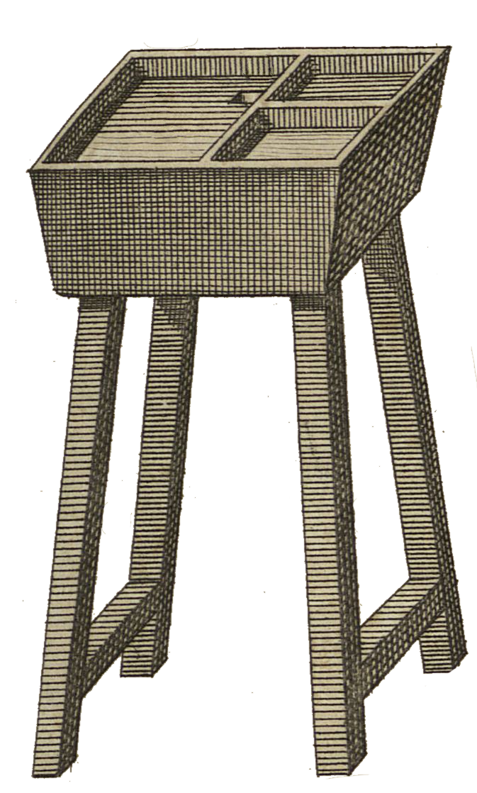

<div align="center" id="head">

<table>
<tr>
<td></td>
<td align="left">
<h1 style="margin:0">PrePrint</h1>
<p style="margin:0.25em 0 0"><strong>Tipografía francesa · Obsidian</strong><br/>Invisibles · conformación Unicode · Typst</p>
</td>
</tr>
</table>

<a href="https://atelier.atechnologie.fr/" title="l'Atelier – asociación de fabricación de libros y herramientas de investigación"></a>  
<sub>Desarrollado por <a href="https://atelier.atechnologie.fr/">l'Atelier</a> — fabricación de libros y herramientas de investigación (EHESS)</sub>

<p>
🇫🇷 <a href="README.md">Français</a> ·
🇬🇧 <a href="README.en.md">English</a> ·
🇩🇪 <a href="README.de.md">Deutsch</a> ·
🇪🇸 <a href="README.es.md"><b>Español</b></a>
</p>

<p>
<a href="https://atelier.atechnologie.fr/"></a>
<a href="https://github.com/Atelier-Recherche/PrePrint"></a>
<a href="https://obsidian.md/plugins?search=BRAT#"></a>
</p>

</div>

---

## 📸 Vista previa

| Invisibles | Panel |
| :---: | :---: |
|  |  |

---
## 📖 Acerca de

Plugin Obsidian para la preparación tipográfica francesa: revelador de invisibles y conformación Unicode lista para la edición / la impresión (Typst, etc.).

**Requisito previo:** Obsidian ≥ 1.14.0

---

## ⬇️ Plugin Obsidian (BRAT)

1. 🔌 Instalar **BRAT**: [Obsidian — BRAT](https://obsidian.md/plugins?search=BRAT#)
2. ➕ Añadir este repositorio con la opción *« Add Beta plugin »*:  
   `https://github.com/Atelier-Recherche/PrePrint`

> 💡 Nuestros plugins pueden estar pendientes de validación en el catálogo Obsidian; BRAT permite probarlos ya. Ver también 🌐 [l’Atelier](https://atelier.atechnologie.fr/).

---

## ✨ Funciones

- **Revelador de invisibles** — destaca espacios inseparables, espacios finos, guiones, espacios al final de línea, guiones especiales, tabulaciones
- **Conformación tipográfica** — aplica un perfil de reglas (nota entera o selección)
- **Panel Preprint** — vista previa de los cambios antes de aplicarlos
- **Perfiles** — Édition FR, Web, Minimal (reglas activables / desactivables)
- **Listas blancas** — unidades, meses, abreviaturas, compuestos, etc.
- **Enmascarado** — matemáticas y wikilinks protegidos durante la conformación

---

## 📐 Reglas

| Regla | Efecto |
| --- | --- |
| Limpieza | Espacios dobles, fin de línea, puntos suspensivos |
| Apóstrofo | `'` → `’` |
| Puntuación doble | Espacios inseparables delante de `: ; ! ?` |
| Comillas y diálogo | Comillas francesas, guiones de réplica |
| Guiones de inciso | Rayas para los incisos |
| Números y unidades | Miles, unidades, exponentes, ordinales |
| Horas y fechas | Enlaces del tipo `18 h 30`, `27 juillet` |
| Abreviaturas | `p. ex.`, `n°`, `etc.`, … |
| Llamadas de nota | Espacio fino antes de las llamadas |
| Teléfonos FR | Grupos `01 23 45 67 89` (opcional) |
| Signo menos | Menos tipográfico `−` (opcional) |
| Guiones inseparables | Compuestos de la lista blanca (opcional) |

---

## ⌨️ Comandos

- Alternar el revelador de invisibles
- Abrir el panel Preprint
- Conformar la nota activa (perfil actual)
- Conformar la selección (perfil actual)

Atajos: barra de estado (clic para alternar invisibles) e icono de la cinta.

---

## 🛠 Instalación desde el código fuente (dev / local)

```powershell
npm install
npm run build
.\Deploy-LocalPlugin.ps1
```

Por defecto, el script copia el plugin a `D:\Notes\.obsidian\plugins\preprint`. Otra bóveda:

```powershell
.\Deploy-LocalPlugin.ps1 -TargetPluginDir "C:\ruta\a\vault\.obsidian\plugins\preprint"
```

Sin rebuild: `.\Deploy-LocalPlugin.ps1 -SkipBuild`

Luego activar **Preprint** en Ajustes → Complementos de la comunidad.

---

## 💻 Desarrollo

```bash
npm install
npm run dev      # watch esbuild
npm run build    # typecheck + bundle de producción
npm test
```

Estructura útil:

```
src/
  engine/       # conformación, enmascarado, stats
  invisibles/   # extensión CodeMirror + tema
  rules/        # reglas tipográficas
  profiles/     # perfiles por defecto
  ui/           # panel y vista previa
```

### Release

Árbol Git limpio, luego:

```powershell
.\Release-Plugin.ps1              # bump patch
.\Release-Plugin.ps1 -BumpKind Minor
.\Release-Plugin.ps1 -BumpKind Major
```

Incrementa `package.json` / `manifest.json` / `versions.json`, construye, hace commit, tag y push (para la GitHub Action de release).

---

## 📄 Licencia

MIT

---

## 🌐 Enlaces

- 🌐 [l’Atelier](https://atelier.atechnologie.fr/)
- 📦 [Repositorio GitHub](https://github.com/Atelier-Recherche/PrePrint)
