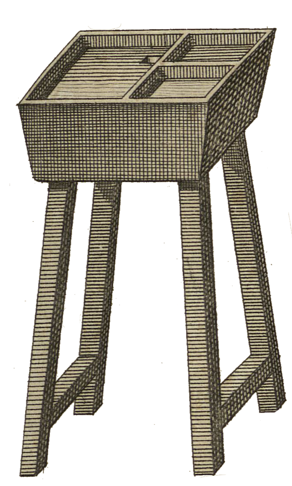

<div align="center" id="head">

<table>
<tr>
<td></td>
<td align="left">
<h1 style="margin:0">PrePrint</h1>
<p style="margin:0.25em 0 0"><strong>Typographie française · Obsidian</strong><br/>Invisibles · conformation Unicode · Typst</p>
</td>
</tr>
</table>

<a href="https://atelier.atechnologie.fr/" title="l'Atelier – Association de fabrication de livres et d'outils de recherche"></a>  
<sub>Développé par <a href="https://atelier.atechnologie.fr/">l'Atelier</a> — fabrication de livres et outils de recherche (EHESS)</sub>

<p>
🇫🇷 <a href="README.md"><b>Français</b></a> ·
🇬🇧 <a href="README.en.md">English</a> ·
🇩🇪 <a href="README.de.md">Deutsch</a> ·
🇪🇸 <a href="README.es.md">Español</a>
</p>

<p>
<a href="https://atelier.atechnologie.fr/"></a>
<a href="https://github.com/Atelier-Recherche/PrePrint"></a>
<a href="https://obsidian.md/plugins?search=BRAT#"></a>
</p>

</div>

---

## 📸 Aperçu

| Révélateur | Panneau |
| :---: | :---: |
|  |  |

---
## 📖 À propos

Plugin Obsidian pour la préparation typographique française : révélateur d’invisibles et conformation Unicode prête pour l’édition / le print (Typst, etc.).

**Prérequis :** Obsidian ≥ 1.14.0

---

## ⬇️ Plugin Obsidian (BRAT)

1. 🔌 Installer **BRAT** : [Obsidian — BRAT](https://obsidian.md/plugins?search=BRAT#)
2. ➕ Ajouter ce dépôt avec l’option *« Add Beta plugin »* :  
   `https://github.com/Atelier-Recherche/PrePrint`

> 💡 Nos plugins peuvent être en attente de validation sur le catalogue Obsidian ; BRAT permet de les tester dès maintenant. Voir aussi 🌐 [l’Atelier](https://atelier.atechnologie.fr/).

---

## ✨ Fonctionnalités

- **Révélateur d’invisibles** — met en évidence espaces insécables, espaces fines, tirets, espaces en fin de ligne, traits d’union spéciaux, onglets
- **Conformation typo** — applique un profil de règles (note entière ou sélection)
- **Panneau Preprint** — aperçu des changements avant application
- **Profils** — Édition FR, Web, Minimal (règles activables / désactivables)
- **Listes blanches** — unités, mois, abréviations, composés, etc.
- **Masquage** — math et wikilinks protégés pendant la conformation

---

## 📐 Règles

| Règle | Effet |
| --- | --- |
| Nettoyage | Espaces doubles, fin de ligne, points de suspension |
| Apostrophe | `'` → `’` |
| Ponctuation double | Espaces insécables devant `: ; ! ?` |
| Guillemets & dialogue | Guillemets français, tirets de réplique |
| Tirets d’incise | Cadratins pour les incises |
| Nombres & unités | Milliers, unités, exposants, ordinaux |
| Heures & dates | Liaisons du type `18 h 30`, `27 juillet` |
| Abréviations | `p. ex.`, `n°`, `etc.`, … |
| Appels de note | Espace fine avant les appels |
| Téléphones FR | Groupes `01 23 45 67 89` (optionnel) |
| Signe moins | Moins typographique `−` (optionnel) |
| Traits d’union insécables | Composés de la liste blanche (optionnel) |

---

## ⌨️ Commandes

- Basculer le révélateur d’invisibles
- Ouvrir le panneau Preprint
- Conformer la note active (profil actuel)
- Conformer la sélection (profil actuel)

Raccourcis : barre d’état (clic pour basculer les invisibles) et icône ruban.

---

## 🛠 Installation depuis les sources (dev / local)

```powershell
npm install
npm run build
.\Deploy-LocalPlugin.ps1
```

Par défaut, le script copie le plugin vers `D:\Notes\.obsidian\plugins\preprint`. Autre vault :

```powershell
.\Deploy-LocalPlugin.ps1 -TargetPluginDir "C:\chemin\vers\vault\.obsidian\plugins\preprint"
```

Sans rebuild : `.\Deploy-LocalPlugin.ps1 -SkipBuild`

Puis activer **Preprint** dans Paramètres → Modules complémentaires.

---

## 💻 Développement

```bash
npm install
npm run dev      # watch esbuild
npm run build    # typecheck + bundle production
npm test
```

Structure utile :

```
src/
  engine/       # conformation, masquage, stats
  invisibles/   # extension CodeMirror + thème
  rules/        # règles typographiques
  profiles/     # profils par défaut
  ui/           # panneau & aperçu
```

### Release

Arbre Git propre, puis :

```powershell
.\Release-Plugin.ps1              # bump patch
.\Release-Plugin.ps1 -BumpKind Minor
.\Release-Plugin.ps1 -BumpKind Major
```

Incrémente `package.json` / `manifest.json` / `versions.json`, build, commit, tag et push (pour la GitHub Action de release).

---

## 📄 Licence

MIT

---

## 🌐 Liens

- 🌐 [l’Atelier](https://atelier.atechnologie.fr/)
- 📦 [Dépôt GitHub](https://github.com/Atelier-Recherche/PrePrint)
